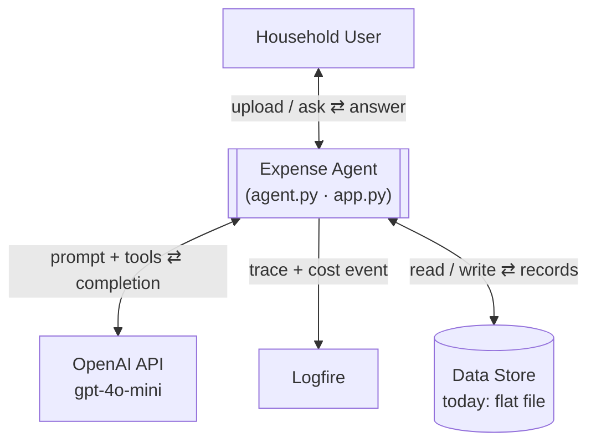
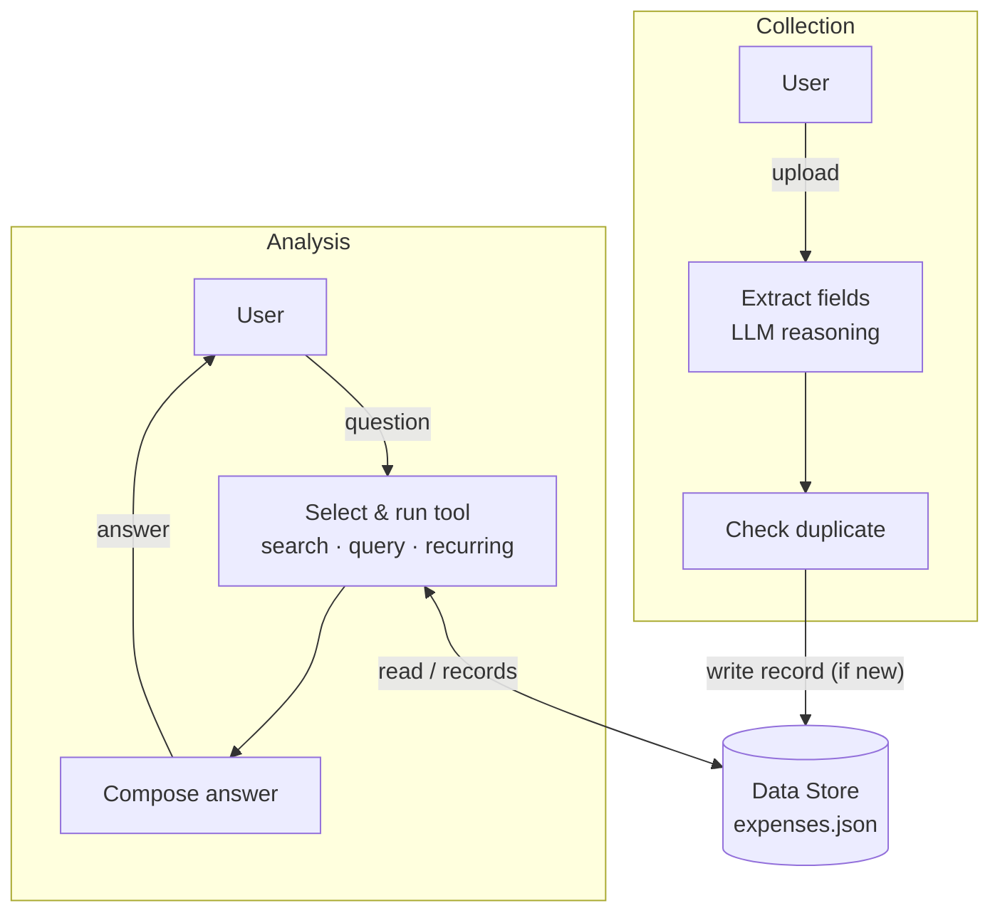
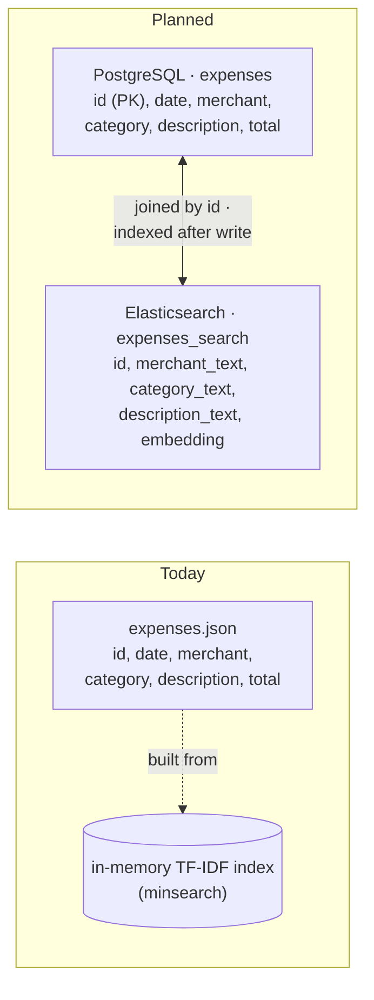
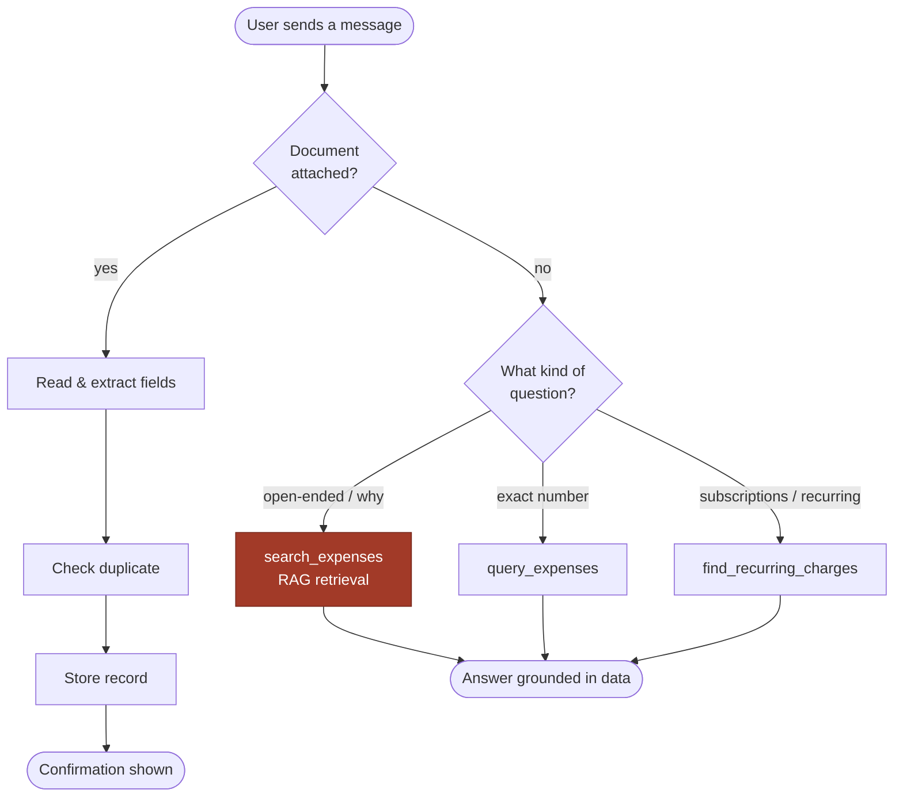
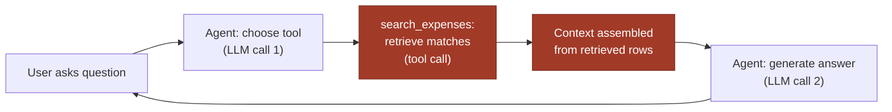

# System Diagrams

Mermaid source for the five diagrams in `PROJECT_OVERVIEW.md` / `ARCHITECTURE.md`.
Renders natively on GitHub and in VS Code's Markdown preview. For a styled,
rendered version (ledger-exhibit treatment, RAG steps highlighted in red),
see the published artifact version of this page.

## 1. Context Diagram

What crosses the system boundary, and in which direction.

## 2. Data Flow Diagram

Collection only writes; analysis only reads. Both touch one store.

## 3. Data Structure Diagram (today vs. planned)

Same six fields either way — the real change is splitting source of truth
from search copy.

## 4. User Behaviour Diagram

The routing decision: document vs. question, then which kind of question.
The `search_expenses` path is the RAG path.

## 5. Business Flow Diagram — with RAG

One open-ended question, end to end. The RAG hop (retrieve, then assemble
context) sits between two separate model calls — the first never sees the
data, the second never searches.

Every step above (both LLM calls and the tool call) is captured as its own
span inside one Logfire trace per session, with a `session_cost` event
totalling token usage across both LLM calls.
